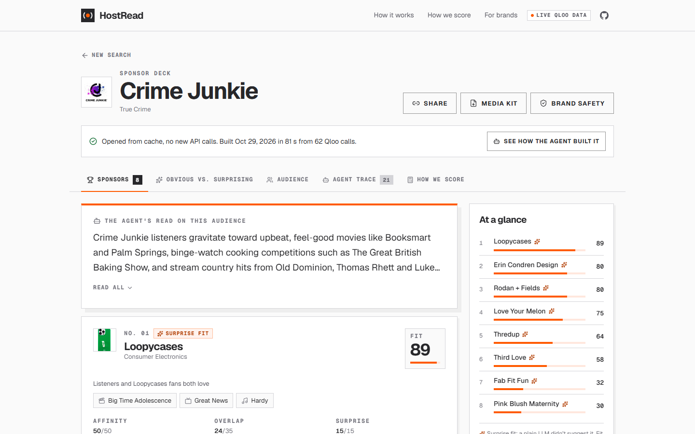
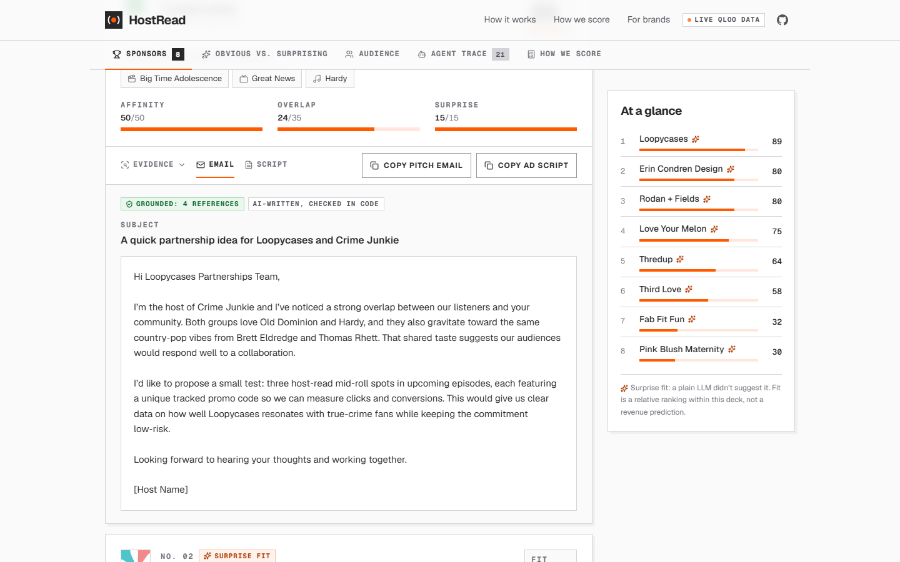
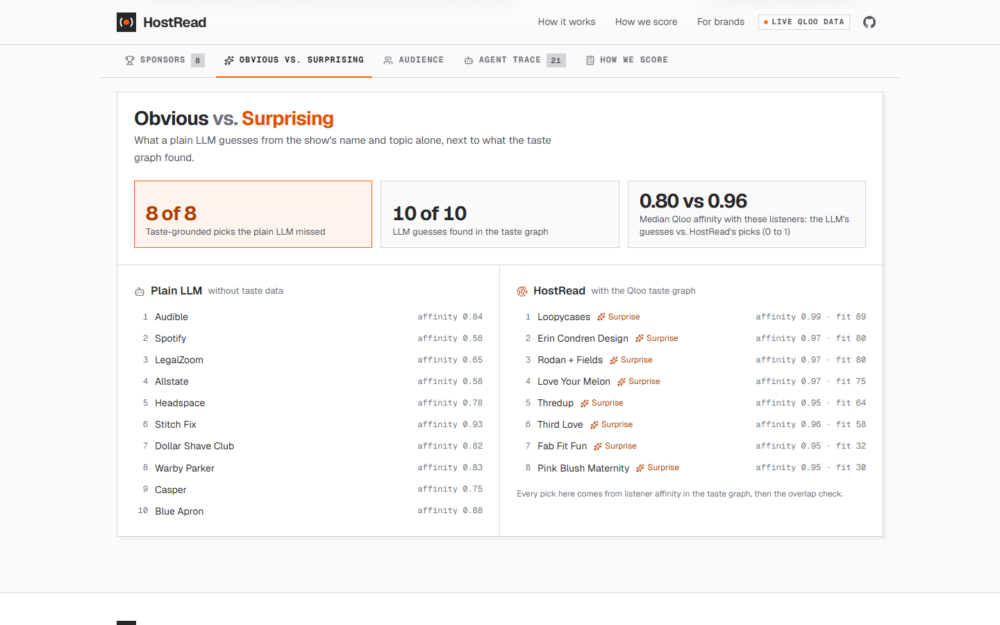
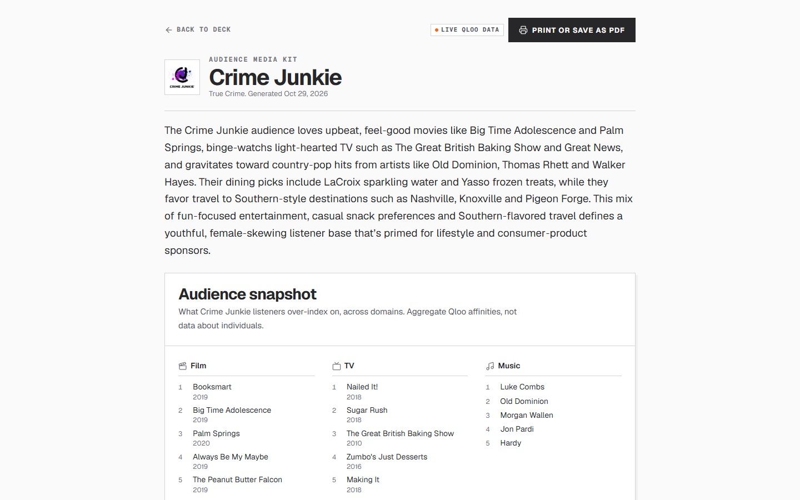
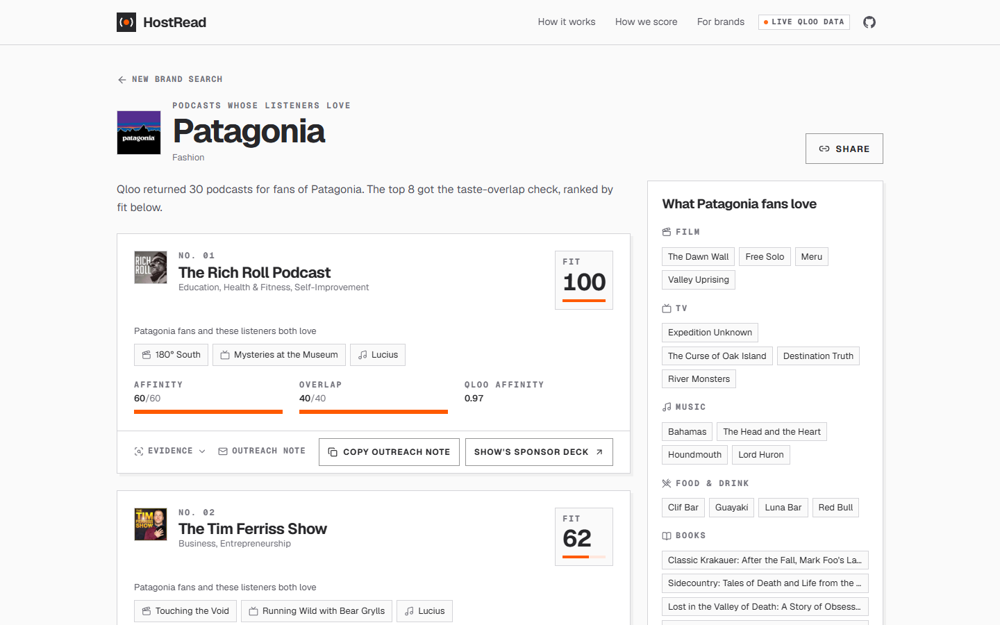
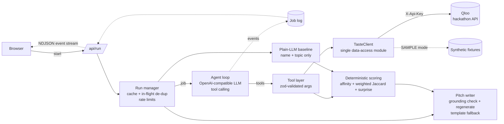

# HostRead

**Find the sponsors your listeners already love. Get the pitch written.**

HostRead is an agentic tool for independent podcasters and small networks without an ad-sales team. Type a show's name; an LLM agent uses the [Qloo](https://www.qloo.com) taste graph to map what that show's listeners love across film, TV, music, food & drink, books and places, finds the brands those listeners over-index on, checks how much each brand's fans share the same tastes, and returns a ranked **sponsor deck** — with the evidence, a pitch email and a 45–60 second host-read ad script for each brand.

It also runs the other way round: a brand enters its name and gets the **podcasts whose listeners already love it** ([/brands](https://hostread.vercel.app/brands)). An [MCP server](mcp/README.md) puts both in any agent's hands.

- **Live demo:** https://hostread.vercel.app (live Qloo data)
- **Built for:** the [Qloo Agentic Hackathon](https://qloo.devpost.com) (Oct 2026)
- **Licence:** MIT

| | |
|---|---|
|  |  |
|  |  |



_Screenshots from the live demo with Qloo data: Crime Junkie's sponsor deck, and Patagonia in brand-side mode._

## What you get

| | |
|---|---|
| **Ranked sponsor deck** | Brands ranked by a transparent fit score, each with its top three “listeners also love” evidence chips and an expandable, per-domain evidence view. |
| **Surprise fits** | Every deck runs a plain-LLM baseline that sees only the show's name and topic. Brands the taste graph surfaces but the LLM never guessed get a **Surprise fit** badge. |
| **Obvious vs. Surprising panel** | The LLM's guesses side by side with the taste-grounded picks, with how (and whether) each LLM guess actually registers with this audience. |
| **Pitch email + ad script** | Written per brand, grounded in this run's data: they may only cite entities the API returned, and code checks that. **Copy pitch email** / **Copy ad script** buttons. |
| **Audience snapshot / media kit** | The show's taste profile across domains (plus demographics and geography when available), with a print/PDF-friendly media-kit view. |
| **Brand safety** | Toggle off alcohol, gambling, tobacco/vaping, cannabis/CBD, crypto, firearms or adult brands before ranking. |
| **Live agent trace** | Every step streams in: which tool the agent chose and why, parameters, timing, API-call counts, cache hits and guardrail interventions. |
| **Shareable results** | Every deck has a URL; repeat views come from cache and are instant. |
| **Brand-side mode** | A brand gets the podcasts whose listeners already love it, ranked by a second transparent formula, with the shared tastes as evidence, a template outreach note, and a link to each show's own sponsor deck. No LLM involved. |
| **MCP server** | `search_podcasts`, `sponsor_deck`, `write_pitch`, `search_brands` and `podcasts_for_brand` for Claude Desktop, Claude Code or any MCP client ([mcp/](mcp/README.md)). |

## How Qloo is used — and why an LLM alone can't do this

An LLM knows what a show is *about*. It does not know what that show's listeners do with the rest of their lives, which brands they over-index on, or which brands' fans share their taste. That is behavioural, cross-domain affinity data — exactly what Qloo's taste graph holds. Without it, “who should sponsor a true-crime show?” collapses into the same category-default answers for every show in the genre.

All calls go to `https://hackathon.api.qloo.com` from server-side code, with the key in the `X-Api-Key` header.

| Endpoint & parameters | What it powers |
|---|---|
| `GET /search?types=urn:entity:podcast` | Autocomplete on the landing page; resolving a typed show name to a Qloo entity (the agent's `resolve_podcast` tool). |
| `GET /v2/insights?filter.type=urn:entity:brand&signal.interests.entities=<show>` | **Candidate sponsors** ranked by affinity among the show's listeners → the **A** term of the fit score (`brand_candidates`). |
| `GET /v2/insights?filter.type=urn:entity:{movie,tv_show,artist,book,destination,podcast}&signal.interests.entities=<show>` | The **audience taste profile** across domains (`audience_profile`) — the media kit, and the listeners' side of the overlap. Food & drink uses `urn:entity:brand` with `filter.tags=urn:tag:genre:brand:food_and_beverage` (place results cluster around one city; see [API_NOTES.md](API_NOTES.md)). |
| `GET /v2/insights?filter.type=…&signal.interests.entities=<brand>&filter.results.entities=<listeners' top 20>` | How much each candidate brand's **fans** like the listeners' favourites (`brand_fan_profile`) — the other side of the overlap → the **O** term and the evidence chips. |
| `GET /v2/insights?filter.type=urn:entity:brand&filter.results.entities=<ids>` | How the plain LLM's guessed brands actually score with this audience (Obvious vs. Surprising). |
| `GET /search?types=urn:entity:brand` | Resolving the plain LLM's brand names to Qloo entities; brand autocomplete in brand-side mode. |
| `GET /entities?entity_ids=<id>` | Opening a shared link: the show or brand by id. |
| `GET /v2/insights?filter.type=urn:entity:podcast&signal.interests.entities=<brand>` | Brand-side mode: **podcasts** ranked by affinity among the brand's fans → its **A** term. |
| `GET /v2/insights?filter.type=…&signal.interests.entities=<podcast>&filter.results.entities=<brand fans' top 20>` | Brand-side mode: how much each show's listeners like the brand fans' favourites → its **O** term and evidence. |
| `GET /v2/insights?filter.type=urn:demographics` | Age and gender skew of the audience (`demographics`). |
| `GET /v2/insights?filter.type=urn:heatmap&filter.location.query=United States&output.heatmap.boundary=urn:geohash` | Where the audience over-indexes (`geography`): geohash cells grouped into US metros in code. |

Qloo data is cached at runtime (memory, optional Redis-compatible KV, and finished decks in a private Vercel Blob store). Nothing from the API is committed to this repository. What we verified about coverage, limits and parameters is in [API_NOTES.md](API_NOTES.md).

## How the agent works



1. **Resolve** the show (autocomplete picks an id; free text goes through `resolve_podcast`).
2. In parallel, a **plain-LLM baseline** guesses ten sponsors from the show's name and topic only — no taste data.
3. The **agent** (an LLM in a tool-calling loop) calls `audience_profile`, `brand_candidates`, chooses which brands to investigate (varied categories, no near-duplicates, plausible podcast sponsors), calls `brand_fan_profile`, `overlap_evidence`, `demographics`, `geography`, then `rank_sponsors`, and writes a short read on the audience.
4. **Scoring is code, not the LLM.** `rank_sponsors` resolves the baseline's brands against Qloo and computes the fit score.
5. The **writer** drafts a pitch email and ad script for the top brands (others on demand). A checker extracts every proper-noun reference and rejects any entity the API didn't return in this run; the writer regenerates with feedback, and falls back to a deterministic template if needed.

**Guardrails:** max agent steps, a per-run API-call budget, a run time budget, timeouts and retries with exponential backoff on every call, at most 4 concurrent Qloo requests, zod validation of every tool argument. If the LLM stops early or is unreachable, the guardrails complete the plan with the same tools (marked in the trace), so a deck is always produced.

**Runs are jobs.** `POST /api/run` returns a cached deck instantly, joins a run already in flight for the same show and settings, or starts a job that writes its trace events to a job log. How the browser reads that log depends on the host (`RUN_EXECUTION`): on Vercel the start request runs the job and streams its events back as NDJSON within one 300-second function (`stream`); on a long-lived Node server the browser polls `/api/run/events` (`inline`); on Netlify, where normal functions stop at 60 s, a background function runs the job and the log lives in Netlify Blobs (`background`).

**Ollama/gpt-oss resilience:** Ollama sometimes answers a gpt-oss tool call with HTTP 500 “error parsing tool call”. The client retries, then switches to *text tool mode*: tools are described in the prompt, the model replies with JSON, and our code parses it.

## How we score

```
Fit = 100 × (0.50·A + 0.35·O + 0.15·S)
```

- **A — audience affinity:** Qloo's affinity of the brand among the show's listeners, min–max normalised across the candidate pool.
- **O — taste overlap:** for the listeners' top 20 favourites in each of film, TV, music, books and food & drink, Qloo returns the listeners' affinity (wL) and, with the brand as the signal and `filter.results.entities`, the brand fans' affinity for the same items (wB). The weighted Jaccard `Σ min(wL, wB) / Σ max(wL, wB)` is averaged across domains and min–max normalised within the deck. An item counts as evidence when wB ≥ 0.75; the headline chips favour film, TV and music and the items this brand's fans like more than the deck's other brands do.
- **S — surprise:** 1 if the plain-LLM baseline did not name the brand (fuzzy name match + entity match), else 0. If the baseline is unavailable, S = 0 for everyone.

A fit score is a **relative ranking within one show's deck**, not a prediction of revenue, CPM or conversion. The UI says so wherever scores appear.

### Brand-side mode

```
Fit = 100 × (0.60·A + 0.40·O)
```

The same overlap check, run the other way round, with no LLM in the loop. Qloo returns 30 podcasts for the brand's fans; **A** is each podcast's affinity among them, min–max normalised. For the top 8, **O** compares the brand fans' top 20 favourites in film, TV, music, books and food & drink with each show's listeners' affinity for those items (`filter.results.entities`), using the same weighted Jaccard, normalised within the shortlist. An item is evidence when the listeners score it 0.75 or higher. A fresh match makes 47 Qloo calls and takes about 10 seconds; results are cached and archived like decks, and count against the same rate limits.

## MCP server

[`mcp/`](mcp/README.md) is a small stdio MCP server over the hosted API. It holds no keys, so the Qloo key and the LLM stay behind HostRead's rate limits and caches.

```bash
cd mcp && npm install && npm run check            # lists the tools, calls them on cached examples
claude mcp add hostread -- node "$(pwd)/server.mjs"  # Claude Code; see mcp/README.md for Claude Desktop
```

## Run it locally

Requirements: Node.js 20.9+.

```bash
git clone https://github.com/sarthak-1111/hostread.git
cd hostread
npm install
cp .env.example .env.local   # then edit
npm run dev                  # http://localhost:3000
```

- **No keys at all?** Leave `QLOO_MODE=sample`. The app runs on clearly labelled **synthetic fixtures** (fictional shows, brands and titles) with a SAMPLE DATA banner. With no LLM reachable, the guardrails still produce a deck and template pitches.
- **Live data:** set `QLOO_API_KEY` (and `QLOO_MODE=live`, or leave it unset).
- **LLM:** any OpenAI-compatible endpoint. Locally, Ollama with `gpt-oss:120b` works out of the box (`LLM_BASE_URL=http://localhost:11434/v1`).

```bash
npm test          # unit tests: scoring (both modes), brand-side pipeline on fixtures, grounding checker, writer
npm run typecheck
npm run probe     # API verification probe (needs QLOO_API_KEY); prints a summary only
npm run health    # pre-demo check of a deployment: status, and every landing example cached (warms any that aren't)
```

### Environment variables

| Variable | Default | Purpose |
|---|---|---|
| `QLOO_API_KEY` | — | Qloo hackathon key. Server-side only. |
| `QLOO_MODE` | auto | `live`, `sample`, or unset (live if a key is present). |
| `QLOO_BASE_URL` | `https://hackathon.api.qloo.com` | Qloo API host. |
| `LLM_BASE_URL` | `http://localhost:11434/v1` | OpenAI-compatible base URL. |
| `LLM_MODEL` | `gpt-oss:120b` | Model name at that endpoint. |
| `LLM_API_KEY` | — | Bearer key for hosted endpoints. |
| `LLM_MAX_CONCURRENCY` | `1` | Parallel LLM calls (1 for a local server). |
| `LLM_REASONING_EFFORT` | `low` | Sent as `reasoning_effort`; empty to omit. |
| `AGENT_MAX_STEPS`, `AGENT_MAX_API_CALLS`, `AGENT_RUN_TIMEOUT_MS` | 12, 80, 240000 | Agent guardrails. |
| `RATE_RUNS_PER_IP_10MIN`, `RATE_RUNS_PER_IP_DAY`, `RATE_GLOBAL_RUNS_DAY` | 6, 25, 150 | Limits on fresh runs (cached runs are free). |
| `QLOO_MONTHLY_RESERVE` | 2500 | Fresh runs stop when Qloo's `x-month-ratelimit-remaining` header drops below this (a run makes about 60 calls). |
| `CACHE_RUN_TTL_SEC` | 1209600 | How long a finished deck stays cached (14 days). |
| `LLM_LABEL` | — | Shown in the UI instead of `<model> @ <endpoint host>`. |
| `RUN_EXECUTION` | `inline` | `stream` runs the job inside the start request and streams events back (Vercel); `inline` runs it in the server and the browser polls; `background` hands it to the Netlify background function. |
| `JOB_SECRET` | — | Shared secret between `/api/run` and the background function (any long random string). |
| `CACHE_BACKEND` | auto | `memory`, `kv` or `blobs` (Netlify Blobs). Unset: `kv` when the KV vars are set, else `memory`. |
| `BLOB_READ_WRITE_TOKEN` | — | Vercel Blob store for finished decks (set by `vercel blob create-store`), so cached decks survive across serverless instances. |
| `KV_REST_API_URL`, `KV_REST_API_TOKEN` | — | Optional Upstash Redis, so the deck cache and rate limits are shared across serverless instances. |

## Deploy (Vercel)

The hosted demo runs on Vercel's free Hobby plan. A run takes 60-100 s, and Hobby functions may run for 300 s, so the run streams back in one request (`RUN_EXECUTION=stream`, `maxDuration = 300` on `/api/run`).

1. Import the GitHub repo in Vercel (framework preset: Next.js; no build settings needed), or run `npx vercel link` and `npx vercel deploy --prod` from a clone.
2. Set the environment variables (*Project → Settings → Environment Variables*, or `vercel env add`): `QLOO_API_KEY`, `LLM_BASE_URL`, `LLM_API_KEY`, `LLM_MODEL`, `LLM_LABEL`, `LLM_MAX_CONCURRENCY` and `RUN_EXECUTION=stream`.
3. Create a private Blob store for finished decks and brand matches, and connect it: `npx vercel blob create-store hostread-decks-private --access private --environment production`. It sets `BLOB_READ_WRITE_TOKEN`; every function instance then reads cached results from the store (authenticated, server-side) instead of re-running the agent. `vercel link` and `create-store` write a `.env.local` into the folder; it is gitignored, but don't deploy from a folder that holds keys you didn't mean to upload.
4. Optional: add Upstash Redis from the Vercel Marketplace (`KV_REST_API_URL`, `KV_REST_API_TOKEN`) to share rate limits and in-flight runs across instances too.

### Other hosts

- **Any long-lived Node server** (`next start`, Render, a VM): `RUN_EXECUTION=inline`; the in-memory cache is enough for one instance.
- **Netlify:** `netlify.toml` declares the Next.js runtime plugin and `netlify/functions/agent-run.mts` is a background function. Set `RUN_EXECUTION=background`, `CACHE_BACKEND=blobs` and a random `JOB_SECRET` in the site's environment variables (variables in `netlify.toml` do not reach functions). Netlify Blobs then holds the deck cache, the job logs and the rate-limit counters.

## Data handling

- The Qloo key and LLM key live only in server env vars; the browser never sees them.
- Only public entity ids (shows, brands) are sent to Qloo — no personal data.
- Qloo responses are normalised to the few fields we use and cached at runtime; raw payloads are never stored or committed.
- Results describe aggregate audiences, not individuals.

## Limitations

- Coverage depends on the taste graph: very small shows may not resolve, or may have thin profiles.
- Fit scores are relative within one deck; they are not comparable across shows and are not revenue forecasts.
- The plain-LLM baseline depends on the model used; a different model guesses different “obvious” brands.
- Generated pitches are drafts. The grounding checker blocks invented cultural references, but hosts should still review tone and add their own product experience (the scripts leave a `[personal experience]` slot for that).
- Without a shared store (Netlify Blobs or Upstash), caches, job logs and rate limits are per server instance.
- Brand-side mode checks the overlap for the top 8 of the 30 podcasts Qloo returns for a brand's fans; the rest are listed by affinity only. Its outreach note is a template, not a written pitch.

## Project layout

```
src/lib/qloo/client.ts   the single taste-data module (live Qloo or SAMPLE fixtures)
src/lib/qloo/sample.ts   synthetic fixtures (fictional, clearly labelled)
src/lib/agent/           run loop, tools, stages, baseline, writer
src/lib/scoring.ts       deterministic fit scoring (sponsor decks and brand-side matches)
src/lib/brandside.ts     brand-side pipeline: podcasts for a brand, reverse overlap
src/lib/grounding.ts     reference extraction + grounding check
src/app/api/run          start or join a run; /api/run/events polls its job log
src/lib/runs.ts          jobs: in-flight marker, job log, inline or background execution
src/lib/cache.ts         memory, Upstash or Netlify Blobs store
netlify/functions/       agent-run background function
src/components/run/      trace, sponsor cards, comparison panel, snapshot, media kit
src/components/brand/    brand-side search, match cards, scoring explainer
mcp/                     stdio MCP server over the hosted API
scripts/probe.mjs        API verification probe
```

## Design credits

- Colours, type and spacing come from the `tom-modern` style in [Open Design](https://github.com/nexu-io/open-design) (Apache-2.0): Geist Sans and Geist Mono, a neutral canvas, one vermillion accent, sharp corners and hard offset shadows. Inspiration only; no third-party logos or wordmarks are used.
- Reviewed against Vercel's [Web Interface Guidelines](https://github.com/vercel-labs/web-interface-guidelines) (MIT) and checked with the Impeccable design detector for contrast, nesting and layout problems.
- Checked in a real browser with [Playwright CLI](https://github.com/microsoft/playwright-cli) at desktop and phone widths, in light and dark mode.
